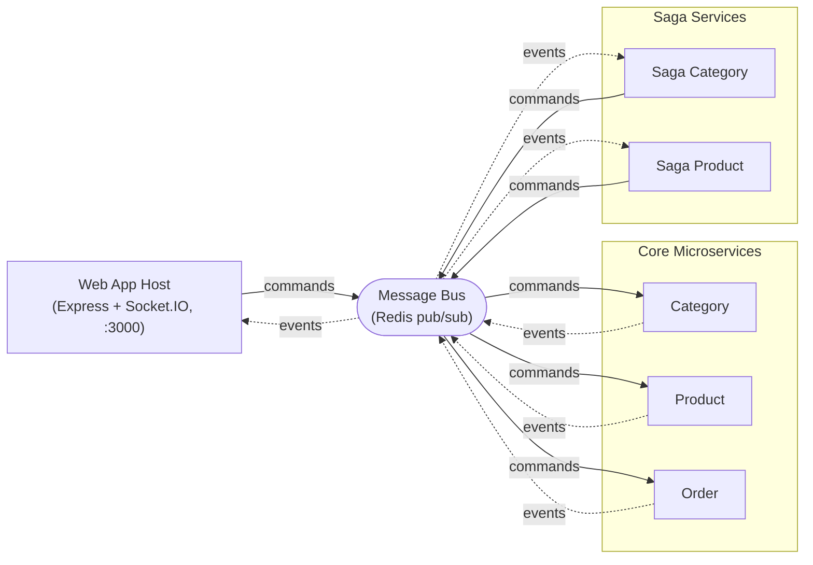

## Introduction

This is a sample implementation of Microservices CQRS / Eventsourcing Infrastructure in Node.js using:
http://cqrs.js.org/

### Architecture

Solid arrows carry **commands**, dashed arrows carry **events**.

### get it up and running
        
1.  Run start.bat
2.  Direct your browser to 

        http://localhost:3000
